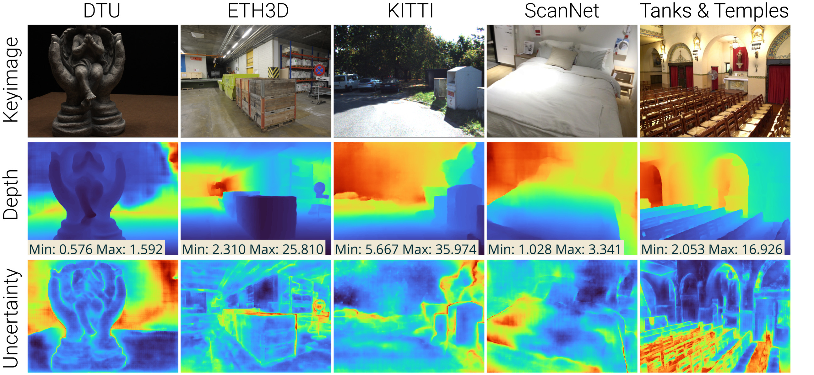

# Robust Multi-view Depth
[**Paper**](http://arxiv.org/abs/2209.06681)

**Robust** **M**ulti-**v**iew **D**epth (`robustmvd`) is a benchmark and framework for depth estimation 
from multiple input views with a focus on robust application independent of the target data. 
This repository contains evaluation code for the Robust Multi-view Depth Benchmark. 
Further, it contains implementations and weights of recent models together with inference scripts.



In the following, we first describe the setup, structure, and usage of the `rmvd` framework. 
Following this, we describe the usage of the Robust Multi-view Depth Benchmark. 

## The `rmvd` framework

### Setup

The code was tested with python 3.13 and PyTorch 2.13 on Ubuntu 24.04 with an RTX 4090.
For the setup, either the `requirements.txt` or the `setup.py` can be used.

To install the requirements, run:
```bash
conda create -y -n rmvd python=3.13
conda activate rmvd
pip install -r requirements.txt
```

To install the package using the `setup.py`, run:
```bash
conda create -y -n rmvd-setuppy python=3.13
conda activate rmvd-setuppy
pip install -e .
```
The package can then be imported via `import rmvd`.

To use the dataloaders from `rmvd`, datasets need to be downloaded and some need to be preprocessed before 
they can be used. For details, see [rmvd/data/README.md](rmvd/data/README.md).

To use the models from `rmvd`, they need to be set up before they can be used.
For details, see [rmvd/models/README.md](rmvd/models/README.md).

#### Original publication environment

<details>
<summary>For completeness, the following describes the environment setup as it was at the time of the paper publication. Note that the more up-to-date environment described above gives similar results.</summary>

At time of publication, the code was used with python 3.8 and PyTorch 1.9 on Ubuntu 20.04. The original setup instructions were:
```bash
conda create -y -n rmvd-legacy python=3.8
conda activate rmvd-legacy
pip install torch==1.9.0 torchvision numpy pillow matplotlib pandas pytoml tqdm opencv-python scikit-image pyqt5 dill easydict wandb
```

Alternatively, on a newer machine, an environment with comparable settings can be set up as follows. This was tested on Ubuntu 24.04 with an RTX 4090:
```bash
conda create -y -n rmvd-orig python=3.8
conda activate rmvd-orig
pip install torch==1.9.0+cu111 torchvision==0.10.0+cu111 numpy==1.23.5 pillow==9.1.0 matplotlib pandas==1.3.2 pytoml tqdm opencv-python-headless scikit-image pyqt5 dill easydict wandb tensorboard gdown termcolor einops setuptools==59.5.0 git+https://github.com/pschroeppel/itypes.git git+https://github.com/pschroeppel/iutils.git git+https://github.com/pschroeppel/iviz.git git+https://github.com/pschroeppel/imetrics.git -f https://download.pytorch.org/whl/torch_stable.html
```

</details>

### Structure

The `rmvd` framework contains dataloaders, models, evaluation/inference scripts for multi-view depth 
estimation. 

The setup and interface of the dataloaders is explained in [rmvd/data/README.md](rmvd/data/README.md).

The setup and interface of the models is explained in [rmvd/models/README.md](rmvd/models/README.md).

### Evaluation script

Evaluation is done with the script `eval.py`, for example on ETH3D:
```bash
python eval.py --model robust_mvd --dataset eth3d --eval_type mvd --inputs poses intrinsics --output /tmp/eval_output --input_size 768 1152 --input_resize_backend cv2_bilinear
```
On KITTI:
```bash
python eval.py --model robust_mvd --dataset kitti --eval_type mvd --inputs poses intrinsics --output /tmp/eval_output --input_size 384 1280 --input_resize_backend cv2_bilinear
```
On DTU:
```bash
python eval.py --model robust_mvd --dataset dtu --eval_type mvd --inputs poses intrinsics --output /tmp/eval_output --input_size 896 1216 --input_resize_backend cv2_bilinear
```
On ScanNet:
```bash
python eval.py --model robust_mvd --dataset scannet --eval_type mvd --inputs poses intrinsics --output /tmp/eval_output --input_size 448 640 --input_resize_backend cv2_bilinear
```
On Tanks and Temples:
```bash
python eval.py --model robust_mvd --dataset tanks_and_temples --eval_type mvd --inputs poses intrinsics --output /tmp/eval_output --input_size 704 1280 --input_resize_backend cv2_bilinear
```

The parameters `eval_type`, `output` and `model` are required. Specifying an evaluation dataset (via the `dataset` `folder` or `dataset_cfg` arguments) is required, except for
evaluating on the `robustmvd` benchmark.

For further parameters, execute `python eval.py --help`.

### Programmatic evaluation

It is also possible to run the evaluation from python code, for example with:
```python
import rmvd
model = rmvd.create_model("robust_mvd", num_gpus=1)
eval = rmvd.create_evaluation(evaluation_type="mvd", out_dir="/tmp/eval_output", inputs=["intrinsics", "poses"])
dataset = rmvd.create_dataset("kitti", "mvd", input_size=(384, 1280))
results = eval(dataset=dataset, model=model)
```

For further details (e.g. additional function parameters, overview of available models, evaluations and datasets, ..),
see the READMEs mentioned above.

### Inference script

Inference is done with the script `inference.py`. The inference supports data from supported research datasets, as well as custom data stored in a local folder.

Running inference on a supported research dataset, for example on KITTI, works as follows:
```bash
python inference.py --output /tmp/inference_output --inference_type mvd --model robust_mvd --dataset kitti --inputs poses intrinsics --max_source_views 6 --input_size 384 1280
```

Running inference on custom data stored in a local folder, for example the `sample_data` folder in this repository, which uses the `rmvd_sample` folder structure, works as follows:
```bash
python inference.py --output /tmp/inference_output --inference_type mvd --model robust_mvd --folder sample_data rmvd_sample --inputs poses intrinsics
```

For further details on supported folder structures, see [rmvd/data/README.md](rmvd/data/README.md). 

For further parameters of the inference script, execute `python inference.py --help`.

### Programmatic inference

Inference with `rmvd` models can be done programmatically on a whole dataset:
```python
import rmvd
model = rmvd.create_model("robust_mvd", num_gpus=1)
inference = rmvd.create_inference(inference_type="mvd", out_dir="/tmp/inference_output", inputs=["intrinsics", "poses"], max_source_views=6, verbose=True)
dataset = rmvd.create_dataset("kitti", "mvd", input_size=(384, 1280))
inference.run_on_dataset(dataset=dataset, model=model)
```

Inference with `rmvd` models can be done programmatically on a single sample:
```python
import rmvd
model = rmvd.create_model("robust_mvd")
dataset = rmvd.create_dataset("kitti", "mvd", input_size=(384, 1280))
sample = dataset[0]
inference = rmvd.create_inference(inference_type="mvd", inputs=["intrinsics", "poses"], max_source_views=6, verbose=True)
pred = inference(model=model, sample=sample)
```

### Training script

Training is done with the script `train.py`, for example to train the `robust_mvd` model:
```bash
python train.py --training_type mvd --model robust_mvd --output /tmp/rmvd_train --num_gpus 1 --batch_size 4 --max_iterations 600000 --inputs poses intrinsics --optimizer adam --lr 1e-4 --grad_clip_max_norm 5 --scheduler flownet_scheduler --loss robust_mvd_loss --dataset staticthings3d.robust_mvd.mvd --dataset blendedmvs.robust_mvd.mvd --augmentations_per_dataset robust_mvd_augmentations_staticthings3d --augmentations_per_dataset robust_mvd_augmentations_blendedmvs --batch_augmentations robust_mvd_batch_augmentations --seed 42
```
This reproduces the training of the `robust_mvd` model from the publication. Note that the `robust_mvd` model is 
currently the only model that can be trained within the framework. All other models are wrappers around the original 
implementations and can only be used for inference and evaluation.

The parameters `training_type`, `model`, `output`, `batch_size`, `max_iterations`, `optimizer`, `scheduler`, and
`loss` are required. At least one `dataset`, `folder`, or `dataset_cfg` argument must also be specified.

The parameters `dataset`, `folder`, and `dataset_cfg` can be specified multiple times to train on multiple registered datasets, custom folders, or dataset configs jointly.
Augmentations are then either specified once for all datasets/folders/configs (`--augmentations`) or once per dataset/folder/config (`--augmentations_per_dataset`, which 
has to be specified as often as there are `--dataset`, `--folder`, and `--dataset_cfg` arguments combined).

Training progress is logged to tensorboard and optionally to wandb if the `--wandb` flag is used. 

For further parameters, execute `python train.py --help`.

### Programmatic training

It is also possible to run the training from python code. The following corresponds to the `train.py` call above:
```python
import rmvd
from rmvd.utils import writer
writer.setup_writers(log_tensorboard=True, log_wandb=False, max_iterations=600000, tensorboard_logs_dir="/tmp/rmvd_train/tensorboard_logs")
model = rmvd.create_model("robust_mvd", pretrained=False, train=True, num_gpus=1)
staticthings3d = rmvd.create_dataset("staticthings3d.robust_mvd.mvd", augmentations=["robust_mvd_augmentations_staticthings3d"])
blendedmvs = rmvd.create_dataset("blendedmvs.robust_mvd.mvd", augmentations=["robust_mvd_augmentations_blendedmvs"])
dataset = rmvd.create_compound_dataset(datasets=[staticthings3d, blendedmvs])
optimizer = rmvd.create_optimizer("adam", model=model, lr=1e-4)
scheduler = rmvd.create_scheduler("flownet_scheduler", optimizer=optimizer)
loss = rmvd.create_loss("robust_mvd_loss", model=model)
training = rmvd.create_training(training_type="mvd", out_dir="/tmp/rmvd_train", model=model, dataset=dataset,
                                optimizer=optimizer, scheduler=scheduler, loss=loss,
                                batch_size=4, max_iterations=600000, inputs=["intrinsics", "poses"],
                                batch_augmentations=["robust_mvd_batch_augmentations"],
                                grad_clip_max_norm=5)
training()
```

Note that for tensorboard/wandb logging, it is required that the writers are set up before the training is run.

### Conventions and design decisions

Within this package, we use the following conventions:
- all data is in float32 format
- all data on an image grid uses CHW format (e.g. images are 3HW, depth maps 1HW); batches use NCHW format (e.g. images
  are N3HW, depth maps N1HW)
- models output predictions potentially at a downscaled resolution
- resolutions are indicated as (height, width) everywhere
- if the depth range of a scene is unknown, we consider a default depth range of (0.1m, 100m)
- all evaluations use numpy arrays as input and outputs
- all evaluations use a batch size of 1 for consistent runtime measurements
- GT depth values / inverse depth values of <=0 indicate invalid values
- predicted depth / inverse depth values of ==0 indicate invalid values

## Robust Multi-view Depth Benchmark

The Robust Multi-view Depth Benchmark (Robust MVD) aims to evaluate robust multi-view depth estimation on arbitrary 
real-world data. As proxy for this, it uses test sets based on multiple diverse, existing datasets and evaluates in 
a zero-shot fashion.

It supports multiple different input modalities:
- images
- intrinsics
- ground truth poses
- ground truth depth range (minimum and maximum values of the ground truth depth map)

It optionally supports alignment of predicted and ground truth depth maps to account for scale-ambiguity of some models.

Depth and uncertainty estimation performance is measured with the following metrics:
- Absolute relative error (rel)
- Inliers with a threshold of 1.03
- Sparsification Error Curves
- Area Under Sparsification Error (AUSE)

The following describes how to evaluate on the benchmark.

### Evaluation of models within the `rmvd` framework

Evaluation on the benchmark is done with the script `eval.py`, e.g.:
```bash
python eval.py --model robust_mvd --eval_type robustmvd --inputs poses intrinsics --output /tmp/eval_benchmark --eth3d_size 768 1152 --kitti_size 384 1280 --dtu_size 896 1216 --scannet_size 448 640 --tanks_and_temples_size 704 1280 --input_resize_backend cv2_bilinear
```

The script `eval_all.sh` allows evaluation of all models in the `rmvd` framework on the benchmark:
```bash
./eval_all.sh -o /tmp/eval_benchmark
```

### Programmatic evaluation

It is also possible to run evaluation on the benchmark from python code, for example with:
```python
import rmvd
model = rmvd.create_model("robust_mvd", num_gpus=1)  # call with num_gpus=0 for CPU usage
eval = rmvd.create_evaluation(evaluation_type="robustmvd", out_dir="/tmp/eval_benchmark", inputs=["intrinsics", "poses"])
results = eval(model=model, eth3d_size=(768, 1152), kitti_size=(384, 1280), dtu_size=(896, 1216), scannet_size=(448, 640), tanks_and_temples_size=(704, 1280))
```

### Evaluation of custom models

With the programmatic evaluation described above, it is possible to evaluate custom models on the Robust MVD Benchmark.

The only constraint is that the custom model that is passed to `eval(model=model, ..)` needs to have the following 
functions:
- a `input_adapter` function
- a `__call__` function (in `torch` basically equivalent to the `forward` function) 
- a `output_adapter` function

These functions are basically used to convert data between the formats of the `rmvd` framework and the model-specific
format and to call the model. For details about these functions, see [rmvd/models/README.md](rmvd/models/README.md).

## TODOs

- [ ] add models that were evaluated in the publication to the `rmvd` framework
- [ ] add code to gather and visualize benchmark results
- [ ] add project page including an overview of the benchmark and a leaderboard
- [ ] add code to train more models
- [ ] add code to run inference directly from COLMAP or Meshroom outputs

## Citation

This is the official repository for the publication:
> **[A Benchmark and a Baseline for Robust Multi-view Depth Estimation](http://arxiv.org/abs/2209.06681)**
>
> [Philipp Schröppel](https://lmb.informatik.uni-freiburg.de/people/schroepp), [Jan Bechtold](https://lmb.informatik.uni-freiburg.de/people/bechtolj), [Artemij Amiranashvili](https://lmb.informatik.uni-freiburg.de/people/amiranas), [Thomas Brox](https://lmb.informatik.uni-freiburg.de/people/brox)
> 
> **3DV 2022**

If you find our work useful, please cite:
```bibtex
@inproceedings{schroeppel2022robust,
  author     = {Philipp Schr\"oppel and Jan Bechtold and Artemij Amiranashvili and Thomas Brox},
  booktitle  = {Proceedings of the International Conference on {3D} Vision ({3DV})},
  title      = {A Benchmark and a Baseline for Robust Multi-view Depth Estimation},
  year       = {2022}
}
```

If you use the StaticThings3D dataset, please cite the following two publications (the first one introduces FlyingThings3D and the second one introduces StaticThings3D which is based on FlyingThings3D):
```bibtex
@InProceedings{MIFDB16,
  author    = "N. Mayer and E. Ilg and P. H{\"a}usser and P. Fischer and D. Cremers and A. Dosovitskiy and T. Brox",
  title     = "A Large Dataset to Train Convolutional Networks for Disparity, Optical Flow, and Scene Flow Estimation",
  booktitle = "IEEE International Conference on Computer Vision and Pattern Recognition (CVPR)",
  year      = "2016",
  note      = "arXiv:1512.02134",
  url       = "http://lmb.informatik.uni-freiburg.de/Publications/2016/MIFDB16"
}

@inproceedings{schroeppel2022robust,
  author     = {Philipp Schr\"oppel and Jan Bechtold and Artemij Amiranashvili and Thomas Brox},
  booktitle  = {Proceedings of the International Conference on {3D} Vision ({3DV})},
  title      = {A Benchmark and a Baseline for Robust Multi-view Depth Estimation},
  year       = {2022}
}
```
