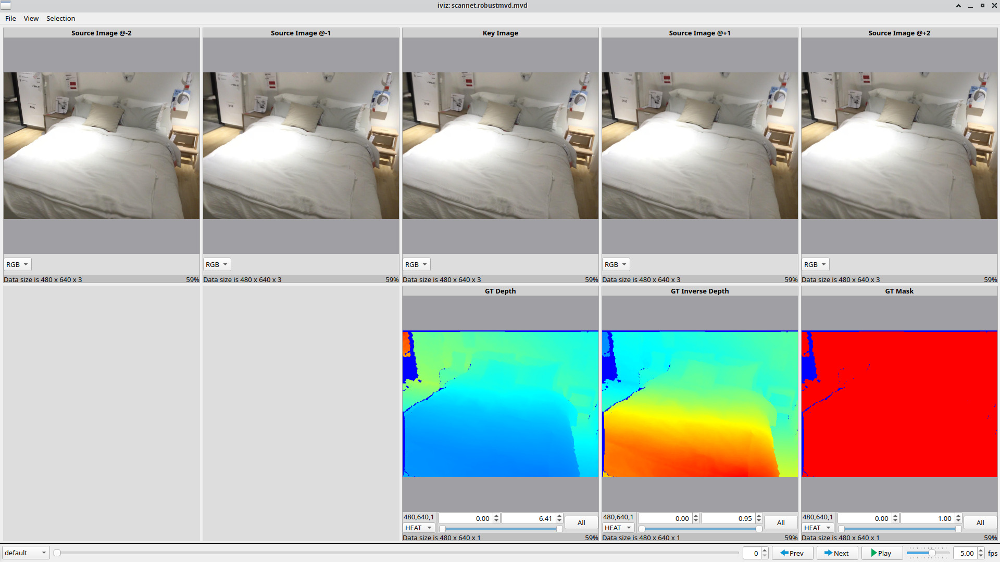

# Data viewer

The data viewer can be used to visualize datasets and evaluation results. 

It is based on the [iViz](https://github.com/eddy-ilg/iviz) project by [Eddy Ilg](https://github.com/eddy-ilg).



Features of the data viewer:
- visualize images and color-coded depth maps
- control the range of the color-coding
- click individual pixels to inspect pixel values (use `CTRL` to select pixels in all images simultaneously)
- zoom in by pressing `SHIFT` and hovering over an image (use `CTRL+SHIFT` to zoom in all images simultaneously)
- select an area by clicking and dragging (use `CTRL` to select areas in all images simultaneously)
- choose between different layouts; each layout shows a different view on the data

---

## Usage
### Viewing a dataset
#### From the command line
The script `data_viewer.py` in the root directory of the `robustmvd` repository can be used to view a dataset, for
example ScanNet:
```bash
./data_viewer.py --dataset scannet.robustmvd.mvd  # optional: --layout layout_name, e.g. --layout all_images
```

For further details, execute `./data_viewer.py --help`.

#### From python code
The data viewer can also be used from python code as follows:
```python
from rmvd import create_dataset, run_viewer
dataset = create_dataset("scannet.robustmvd.mvd")
run_viewer(dataset)  # optional layout=layout_name, e.g. run_viewer(dataset, layout="all_images")
```

#### Viewing data from a local folder
As described in the data README, the `rmvd` framework can load data from a local folder that contains data in a compatible structure.
The data viewer can be used to visualize such data as follows:
```bash
./data_viewer.py --folder sample_data rmvd_sample.mvd
```

For a list of available folder parsers, run:
```bash
./data_viewer.py --help
```

Again, the data viewer can also be used from python code as follows:
```python
from rmvd import create_dataset, run_viewer
dataset = create_dataset("sample_data", folder_parser_name="rmvd_sample.mvd")
run_viewer(dataset)
```

### Viewing evaluation results
The script `data_viewer.py` in the root directory of the `robustmvd` repository can be used to view evaluation results
by specifying the path to the evaluation outputs, for example:
```bash
python eval.py --model robust_mvd_5M --dataset scannet.robustmvd --eval_type mvd --inputs poses intrinsics --output /tmp/eval_output --input_size 448 640 --input_resize_backend cv2_bilinear
./data_viewer.py --dataset_cfg /tmp/eval_output --layout eval_mvd
```

Or in case of evaluating on the Robust Multi-view Depth Benchmark:
```bash
python eval.py --model robust_mvd_5M --eval_type robustmvd --inputs poses intrinsics --output /tmp/eval_benchmark --eth3d_size 768 1152 --kitti_size 384 1280 --dtu_size 896 1216 --scannet_size 448 640 --tanks_and_temples_size 704 1280 --input_resize_backend cv2_bilinear
./data_viewer.py --dataset_cfg /tmp/eval_benchmark/scannet.robustmvd.mvd
./data_viewer.py --dataset_cfg /tmp/eval_benchmark/kitti.robustmvd.mvd
# etc
```

### Viewing inference outputs
The script `data_viewer.py` in the root directory of the `robustmvd` repository can be used to view inference outputs, for example:
```bash
python inference.py --output /tmp/inference_output --inference_type mvd --model robust_mvd --dataset scannet.robustmvd --inputs poses intrinsics --input_size 448 640
./data_viewer.py --dataset_cfg /tmp/inference_output --layout inference_mvd
```

Or for example for inference on custom data (e.g. on the supplied `sample_data` folder):
```bash
python inference.py --output /tmp/inference_output --inference_type mvd --model robust_mvd --folder sample_data rmvd_sample --inputs poses intrinsics --max_source_views 6
./data_viewer.py --dataset_cfg /tmp/inference_output --layout inference_mvd
```

---

## Implementation
The data viewer is structured as a grid where each grid cell displays certain data.

The arrangement of grid cells, as well as functions to load the data to be displayed, is defined by so-called layouts.

Each dataset is associated with a list of layouts. The user can select a layout from the list of layouts.

### MVC design pattern
The data viewer is structured according to a MVC design pattern:
- `ViewerModel` class: Holds the dataset; supplies the layout and the data to the viewer.
- `Viewer` class: Displays the data according to the currently selected layout.
- `ViewerControls` class: Controls the viewer, i.e. allows the user to select a layout and iterate over samples in 
the dataset.
